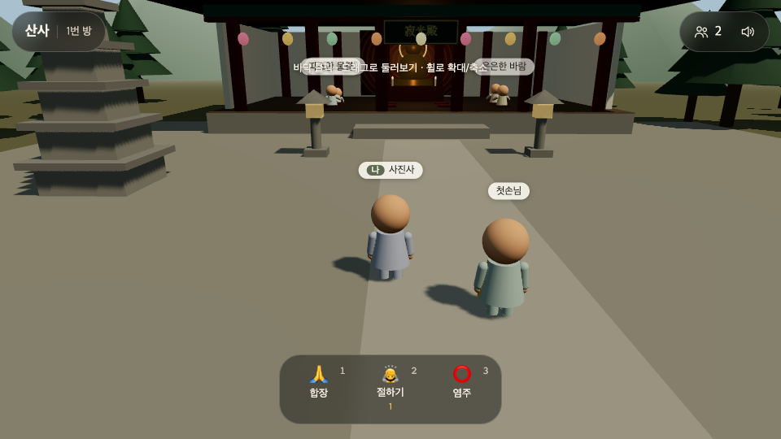
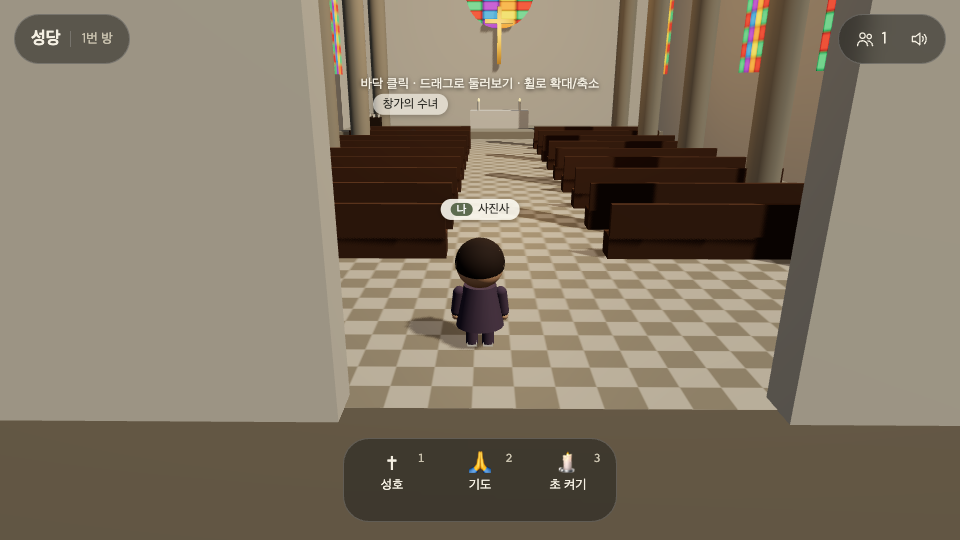
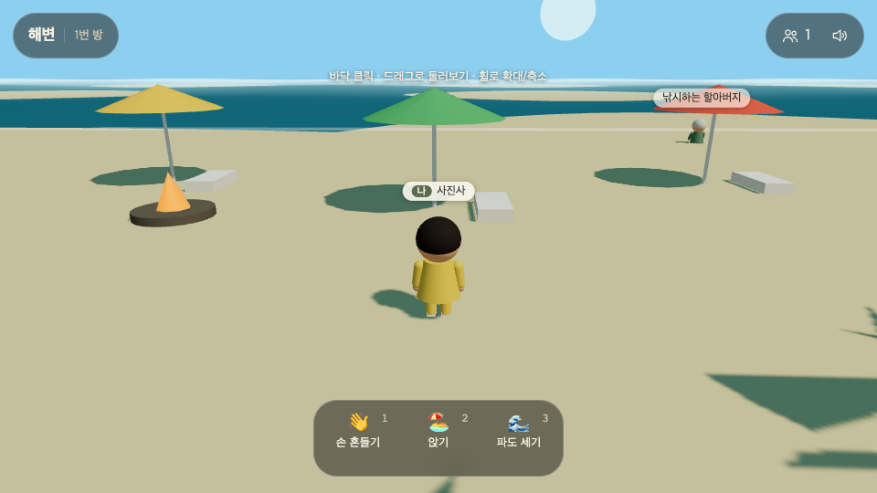

# online-temple-starter

무료로 쓰는 온라인 산사 코드예요. 내가 만든 게임 세상에 다른 사람들을 초대하는 온라인 게임의 기초를 담았습니다.
여러 사람이 브라우저로 들어와 같은 공간에 말없이 머물다 가요. 기본은 온라인 절이고 같은 코드에 설정 파일만 바꾼 성당과 해변도 들어 있습니다. MIT 라이선스라 마음껏 고쳐 쓰셔도 돼요.

| 산사 | 성당 | 해변 |
|---|---|---|
|  |  |  |

## 바로 실행

```bash
git clone https://github.com/gykim80/online-temple-starter.git
cd online-temple-starter
npm install
npm start            # http://localhost:8787
```

브라우저 창을 두 개 열어 보면 서로의 캐릭터가 보입니다.
`?place=cathedral`, `?place=beach` 를 붙이면 다른 장소, `?time=night` 를 붙이면 밤 화면입니다.

## 들어 있는 것

- 바닥 클릭·WASD 로 걷기, 드래그로 둘러보기, 휠·두 손가락으로 확대
- 방 나누기: 방마다 정원(기본 50명)이 차면 다음 방으로 보냄, 방 목록에서 옮기기
- 동작: 합장(한 번), 절하기·염주(켜 두면 반복), 모든 사람의 동작 수 합계
- 늘 앉아 있는 NPC, 현재 시각에 따라 바뀌는 낮·밤, 밤에 켜지는 등불
- 음원 파일 없이 합성한 바람·파도 소리와 목탁·종소리
- 모델 파일 없이 기본 도형으로만 지은 건물과 캐릭터

## 구조

```
server/
  index.js        시작과 종료 (환경 변수 읽기 → 서버 열기 → 끌 때 동작 수 저장)
  app.js          HTTP 경로(/healthz, /api/rooms, 정적 파일)와 WebSocket(/ws)을 Hub 에 잇기
  hub.js          방 배정, 메시지 처리, 0.1초마다 움직임 모아 보내기
  static.js       정적 파일 (ETag 캐시, gzip 압축, 폴더 밖 접근 막기)
  stats.js        장소별 동작 수 세기와 파일 저장 (임시 파일에 쓰고 이름 바꾸기)
  rate-limit.js   1초 단위 메시지 수 제한
  config.js       환경 변수 검사
public/
  index.html      입장 화면, 상단·하단 버튼, 대화상자
  shared/
    protocol.js   서버와 브라우저가 같이 쓰는 약속 (자세 이름, 한계값, 이름·색 검사)
  js/
    main.js       아래 모듈들을 잇는 곳
    player.js     내 캐릭터 (클릭·키보드 이동, 켜고 끄는 동작)
    crowd.js      다른 사람들과 늘 있는 NPC (부드럽게 따라가기, 몸짓)
    net.js        서버 연결, 끊기면 다시 붙기, 움직임 묶어 보내기
    input.js      키보드
    avatar.js     도형 캐릭터와 자세. 모든 캐릭터가 도형·재질을 나눠 씀
    sound.js      소리 합성
    world.js      렌더러·조명·카메라를 만들고 장소를 지음
    world/        daylight.js(낮·밤) · controls.js(드래그·확대·클릭) · collision.js(부딪힘)
    ui/           hud.js(버튼·알림·대화상자) · labels.js(이름표) · dom.js
  places/         장소 설정 (temple.js · cathedral.js · beach.js · index.js · kit.js)
test/
  *.test.js       서버·공통 모듈 단위 테스트 (npm test)
  e2e/run.mjs     브라우저 여러 개로 접속·이동·동작·방 나누기·방 옮기기 확인 (npm run e2e)
```

| 명령 | 하는 일 |
|---|---|
| `npm start` | 서버 실행 |
| `npm run dev` | 파일이 바뀌면 서버 다시 시작 |
| `npm test` | 단위 테스트 |
| `npm run lint` | 코드 검사 |
| `npm run e2e` | 브라우저 테스트, 화면은 `test/e2e/out/` |

## 주고받는 메시지

| 방향 | 메시지 | 내용 |
|---|---|---|
| 접속 → 서버 | `join` | place, room, name, color, 처음 위치 |
| 접속 → 서버 | `move` | x, z, yaw, pose (바뀌었을 때만, 0.1초에 한 번까지) |
| 접속 → 서버 | `act` | kind (hello, bow, bead …) |
| 서버 → 접속 | `welcome` | 내 id, 배정된 방, 먼저 와 있던 사람, 동작 수 |
| 서버 → 접속 | `join` / `leave` | 들어오고 나간 사람 |
| 서버 → 접속 | `moves` | 0.1초 동안 움직인 사람들 `[id, x, z, yaw, pose]` |
| 서버 → 접속 | `act` | 누가 무슨 동작을 했는지와 합계 |

한계값은 `public/shared/protocol.js` 한 곳에 있습니다. 서버는 좌표를 ±90m 로 자르고, 자세 이름과 동작 이름을 검사하고, 이름에서 태그 문자를 지웁니다.
1초에 40개 넘는 메시지는 버리고 200개를 넘기면 연결을 끊습니다.

## 내 장소 만들기

[docs/MAKE-YOUR-OWN.md](docs/MAKE-YOUR-OWN.md) 에 온라인 도서관을 예로 들어 순서대로 적었습니다.
`public/places/temple.js` 를 복사해 이름, 하늘색, 건물, 동작만 바꾸면 됩니다.

## 배포

Node 20 이상이 돌아가는 곳이면 어디든 됩니다. WebSocket 을 지원하는 호스팅(Render, Railway, Fly.io 등)에 올리고 시작 명령을 `npm start` 로 둡니다. 서버는 호스팅이 넣어 주는 `PORT` 환경 변수를 그대로 읽어서 코드를 고칠 필요가 없습니다.

Railway 예 ([Railway CLI](https://docs.railway.com/guides/cli) 로그인 후, 이 폴더에서):

```bash
railway init -n online-temple-starter   # 프로젝트 만들기
railway up                              # 코드 올리기 (빌드는 npm install, 실행은 npm start)
railway domain                          # https://….up.railway.app 주소 받기
```

받은 주소를 PC와 휴대폰에서 열면 같은 방에서 서로 보입니다. 서버를 켜 둔 시간만큼 요금이 나오니, 다 본 뒤에는 Railway 대시보드에서 서비스를 지우거나 멈춰 두세요. 동작 수(`data/stats.json`)는 재배포하면 지워지므로 오래 남기려면 볼륨을 붙이고 `STATS_FILE` 을 그 경로로 둡니다.

| 환경 변수 | 기본값 | 뜻 |
|---|---|---|
| `PORT` | 8787 | 서버 포트 |
| `ROOM_CAPACITY` | 50 | 방 하나 정원 |
| `MAX_ROOMS` | 100 | 장소마다 열 수 있는 방 수 |
| `STATS_FILE` | data/stats.json | 동작 수를 저장할 파일 |

## 참고한 곳

[산사](https://sansatemple.com/) 의 공개된 화면과 동작을 보고 처음부터 다시 만들었습니다. 산사의 코드·모델·음원은 쓰지 않았습니다. 분석 내용은 [docs/ANALYSIS.md](docs/ANALYSIS.md) 에 있습니다.

## 라이선스

MIT
